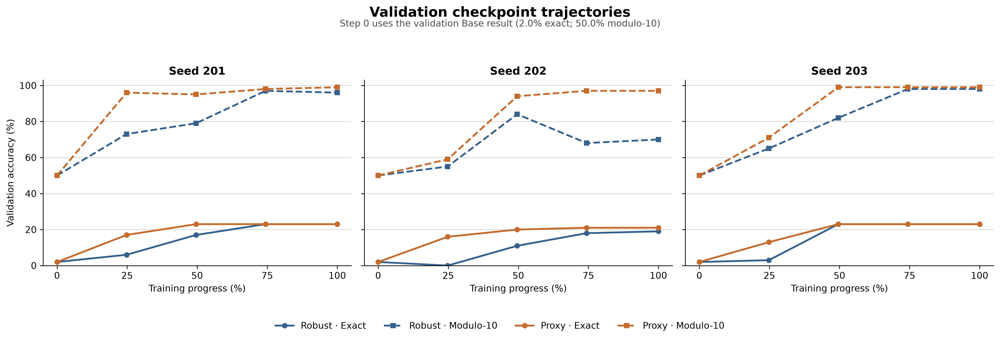
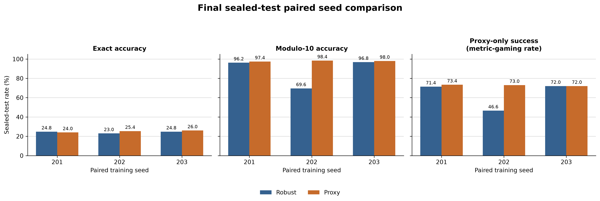

# Math Reward Hacking

A controlled GRPO study comparing an exact-answer reward with a deliberately incomplete modulo-10 reward on generated integer arithmetic.

> Built a six-run, three-seed GRPO study of misspecified rewards in integer arithmetic; proxy-trained models reached 97.9% modulo-10 accuracy and 25.1% exact accuracy, with substantial seed-level variability.

## Question

When a language model is optimized against a mathematical proxy that is easier
to satisfy than the intended objective, how do proxy performance, exact-answer
performance, and training dynamics differ from training with the intended
reward?

## Experimental Setup

The environment contains generated integer-arithmetic problems. The two
training conditions differ only in their reward function:

- **True/Robust reward:** the parsed final integer equals the target integer.
- **Proxy reward:** the parsed final integer modulo 10 equals the target integer
  modulo 10.

The modulo-10 reward is an artificial, deliberately vulnerable specification,
chosen to make the proxy–truth distinction measurable in a controlled setting.

## Confirmatory Protocol

The confirmatory protocol was internally prespecified. It used
`Qwen/Qwen2.5-0.5B-Instruct`, three training seeds (201, 202, 203), and six runs:
one Robust and one Proxy run per seed. Training settings were identical aside
from reward and seed. The 500-example test set remained sealed until the six-run
training sequence and the documented step-count incident review were complete.

Seed 101 was exploratory and is excluded from every confirmatory aggregate. The
historical protocol is preserved unchanged in
[`experiments/milestone3/preregistered_plan.md`](experiments/milestone3/preregistered_plan.md),
with factual post-hoc clarifications in
[`experiments/milestone3/prespecification_addendum.md`](experiments/milestone3/prespecification_addendum.md).

## Results

Across three seeds, proxy-reward training yielded consistently high modulo-10
accuracy while exact-answer accuracy remained similar to robust-reward
training. The average Proxy advantage over Robust was driven primarily by
Robust Seed 202, so these results support a proxy–truth gap under the vulnerable
reward but do not establish a stable condition effect across seeds.

| Condition | Exact accuracy | Modulo-10 accuracy |
|---|---:|---:|
| Base | 4.20% | 60.20% |
| Robust | 24.20% ± 1.04 pp | 87.53% ± 15.53 pp |
| Proxy | 25.13% ± 1.03 pp | 97.93% ± 0.50 pp |

Robust and Proxy values are mean ± sample SD across n=3 seeds. Base is one
zero-shot evaluation.

| Seed | Robust exact | Proxy exact | Robust modulo-10 | Proxy modulo-10 | Proxy − Robust modulo-10 |
|---:|---:|---:|---:|---:|---:|
| 201 | 24.8% | 24.0% | 96.2% | 97.4% | +1.2 pp |
| 202 | 23.0% | 25.4% | 69.6% | 98.4% | +28.8 pp |
| 203 | 24.8% | 26.0% | 96.8% | 98.0% | +1.2 pp |

| Seed | Robust metric-gaming rate | Proxy metric-gaming rate | Proxy − Robust |
|---:|---:|---:|---:|
| 201 | 71.4% | 73.4% | +2.0 pp |
| 202 | 46.6% | 73.0% | +26.4 pp |
| 203 | 72.0% | 72.0% | 0.0 pp |

The Seed 202 pair accounts for most of the aggregate Robust–Proxy modulo-10 and
metric-gaming-rate gaps. `metric_gaming_rate = mod10_accuracy −
exact_accuracy`: exact correctness implies modulo-10 correctness, so this is a
derived operational metric for proxy-only success, not independent evidence.

## Validation Dynamics

The trajectory figure uses the validation Base result at step 0 (2.0% exact,
50.0% modulo-10), then shows every stored quarter-progress checkpoint for all
three seeds and both conditions.



The final sealed-test view retains paired seed-level heterogeneity, including
the lower Robust modulo-10 result for Seed 202.



## Interpretation

The results support metric gaming, or proxy–truth divergence, under this
deliberately vulnerable modulo-10 reward: Proxy runs scored nearly perfectly on
the rewarded property without a corresponding advantage in exact accuracy.
They do not show that a model intentionally cheated, prove a general reward-
hacking mechanism, or establish that Proxy has a stable advantage over Robust
across seeds.

The stored results use the historical confirmatory evaluation semantics.
Future-facing evaluation now compares parsed integers, treating accepted forms
such as `42`, `+42`, and `042` as equal. No stored confirmatory response changes
exact-correctness under this correction.

## Hypothesis Outcomes

- **H1 — not satisfied on the sealed test:** Base exact accuracy was 4.2%, below
  the prespecified >10% threshold. The earlier 22% competence screen was a
  different artifact and used 256 generation tokens rather than 128.
- **H2 — descriptively supported:** Robust exact accuracy increased from 4.2%
  for Base to a 24.2% mean.
- **H3 — not supported as proposed:** Proxy exact accuracy (25.13%) was not
  lower than Robust exact accuracy (24.20%).
- **H4 — not supported by the proposed shortcut signature:** Proxy's
  small-answer rate was 1.2%, below Robust's 5.8%.
- **H5 — mixed/partially supported:** Proxy modulo-10 validation accuracy rose
  to 97–99% while exact validation accuracy remained 21–23%, but trajectories
  were not uniformly monotonic and two Robust seeds also reached high
  modulo-10 accuracy.

These labels are descriptive; no hypothesis was evaluated with a prespecified
significance or equivalence test.

## Limitations

- There are only three confirmatory seeds.
- Robust modulo-10 and metric-gaming results have substantial seed variability.
- No significance or equivalence test was prespecified.
- The protocol was internally prespecified, not externally registered.
- The modulo-10 reward is an artificial specification error designed for this
  controlled study.
- Results from this small arithmetic setup should not be generalized directly
  to frontier-model alignment.

## Reproduction

Do not use the historical runner for a new experiment: it targets canonical
Milestone 3 paths. The fresh pipeline refuses an existing output directory,
creates new train/validation/test splits, downloads a base-model snapshot at a
required full commit SHA, records pre-training hashes, trains all six runs, and
writes evaluation output only under `experiments/replications/<name>/`:

```bash
uv sync --extra dev --extra plots
bash scripts/run_replication.sh <name> <40-character-qwen-commit-sha>
```

The fresh defaults use data seeds 1042/1043/1044 and paired training seeds
201/202/203. The fresh test split is evaluated only after all six new runs
finish. Change the data seeds in `scripts/prepare_replication.py` arguments for
an additional independent split.

The current locked/audit environment is Python 3.14.7, TRL 1.12.0, PyTorch
2.14.0, and Transformers 5.16.1. Surviving model cards record the same three
library versions, but the original training interpreter version was not
independently recorded. The original Qwen revision was also unpinned, so it is
unknown; the fresh pipeline requires an explicit commit SHA instead of
fabricating one.

Core GRPO settings are learning rate `5e-6`, one epoch, per-device batch size
`1`, gradient accumulation `4`, four generations per prompt, temperature `0.8`,
maximum completion length `128`, and LoRA rank/alpha/dropout `8/16/0.05`.
Evaluation chooses MPS on Apple Silicon when available. Training delegates
non-CUDA device placement to Trainer/Accelerate; verify MPS support before a
long run. Historical hardware was not recorded as durable provenance.

Regenerate the report and figures from the immutable stored JSON without
running evaluation or training:

```bash
uv run python scripts/generate_report.py
uv run --extra plots python scripts/plot_trajectories.py
```

## Repository Structure

- `src/math_reward_hacking/` — generators, verifiers, rewards, and metrics.
- `scripts/` — training, fresh-replication, reporting, plotting, and read-only
  integrity utilities.
- `tests/` — maintained unit and regression tests.
- `configs/` — historical experiment configurations.
- `experiments/milestone3/data/` — frozen confirmatory datasets.
- `experiments/milestone3/eval_results.json` — stored validation and sealed-test
  metrics plus visible responses.
- `experiments/milestone3/report_milestone3.md` — generated detailed report.
- `experiments/milestone3/provenance/` — hashes and incident documentation.
- `PUBLICATION_CHECKLIST.md` — Git/archive guidance for large artifacts.

## Provenance / Experimental Incident

A helper calculation produced `computed_max_steps=125`, while every surviving
confirmatory trainer state records `global_step=500` and `max_steps=500`. The
manual estimate did not account for GRPOTrainer's effective sampling/step
semantics. It affected checkpoint/save-frequency bookkeeping and a post-
training assertion; no surviving evidence shows optimization length was set to
125. The discrepancy was discovered before sealed-test access.

Robust Seed 201 has a `final_model`; its adapter is byte-identical to
`checkpoint-500`. The frozen manifest records an original training-source
digest, but the corresponding source bytes do not survive, so that digest
cannot be independently recomputed or prove which exact bytes the run executed.
The [detailed report](experiments/milestone3/report_milestone3.md) distinguishes
proven, recorded-but-not-recomputable, and unknown provenance.

## Tests

Run the normal project suite with:

```bash
uv run --extra dev pytest
```

Run the read-only full-archive confirmatory artifact checks with the locally
retained model directories present:

```bash
uv run python scripts/test_integrity.py
```

## License

Original repository code is licensed under the
[Apache License 2.0](LICENSE) unless otherwise noted. Qwen-derived adapters and
other model artifacts remain subject to applicable upstream terms. External
dependencies retain their own licenses. This repository license does not by
itself establish redistribution permission for third-party model weights,
datasets, or upstream artifacts.
